# Database entity-relationship diagram

This is an inventory of the tables exported by `lib/db/src/schema/index.ts`.
It distinguishes **declared database foreign keys** (the `.references()` calls in
the Drizzle schema) from identifier-shaped columns that are only application
conventions.  In particular, an arrow in the diagram below is a declared FK;
an item in the later “logical/implied” list is **not** an enforced constraint.

## Legend and cardinality

* `PK` marks the single-column primary key (`id`) on every table.
* `FK` marks a column with a declared `.references()` relationship. A nullable
  declared FK is annotated `(nullable)`.
* `P ||--|{ C` means every child row requires one parent (`NOT NULL` FK).
  `P ||--o{ C` means the child’s FK may be absent (nullable FK). Neither form
  says a parent must have a child, and no one-to-one relationship is implied.
* Repeated edges with labels (for example `staff_id` and `supervisor_id`) are
  distinct FK columns to the same parent.

## Domains

The diagram is arranged in these domain blocks (in the same order as the
entity declarations): **hotel/property core** — hotels, branches, buildings,
floors, room categories, bed types, amenities, types, rooms, pricing, images,
and amenity assignments; **guests and stays** — guests, reservations, checkins,
checkouts, and stay changes; **operations** — cleaning, maintenance,
restaurant, POS, and room-service tables; **inventory/procurement** — catalog,
stock, suppliers, requests, orders, and receipts; **finance** — transactions,
cash registers/shifts, credit notes, invoices, invoice lines, and payments;
**HR/staff** — employees, departments, attendance, leave, shifts,
assignments, and reviews; **conference/transport** — halls, equipment,
bookings/services, vehicles, drivers, and trips; **SaaS/platform/security** —
roles/users, tenant configuration, subscriptions, workflows, plugins, MFA,
IP restrictions, sessions, and notification templates; and
**enterprise/admin** — complaints/comments, documents, audit logs, and
notifications.

## Declared foreign-key diagram

```mermaid
erDiagram
  hotels { string id PK }
  branches { string id PK string hotel_id FK }
  buildings { string id PK string branch_id FK }
  floors { string id PK string building_id FK }
  room_categories { string id PK }
  bed_types { string id PK }
  room_amenities { string id PK }
  room_types { string id PK }
  rooms { string id PK string room_type_id FK string room_category_id FK string bed_type_id FK string building_id FK string floor_id FK }
  room_pricing { string id PK string room_id FK }
  room_images { string id PK string room_id FK }
  room_amenity_assignments { string id PK string room_id FK string amenity_id FK }

  guests { string id PK }
  reservations { string id PK string guest_id FK string room_id FK string room_type_id FK }
  checkins { string id PK string reservation_id FK string guest_id FK string room_id FK }
  checkouts { string id PK string reservation_id FK string guest_id FK string room_id FK }
  stay_changes { string id PK string reservation_id FK string guest_id FK string from_room_id FK string to_room_id FK }

  cleaning_areas { string id PK }
  housekeeping_assignments { string id PK string room_id FK string staff_id FK string supervisor_id FK }
  cleaning_inspections { string id PK string task_id FK string inspected_by FK }
  maintenance_categories { string id PK }
  maintenance_requests { string id PK string room_id FK string category_id FK string assigned_to_id FK }
  maintenance_inspections { string id PK string request_id FK string inspected_by FK }
  menu_items { string id PK }
  restaurant_tables { string id PK string waiter_id FK }
  restaurant_orders { string id PK string table_id FK string reservation_id FK string guest_id FK string room_id FK string waiter_id FK }
  restaurant_order_items { string id PK string order_id FK string menu_item_id FK }
  pos_orders { string id PK string table_id FK string waiter_id FK }
  pos_order_items { string id PK string order_id FK string menu_item_id FK }
  room_service_requests { string id PK string reservation_id FK string guest_id FK string room_id FK string assigned_to_id FK }
  room_service_items { string id PK string request_id FK string menu_item_id FK }

  inventory_categories { string id PK }
  inventory_items { string id PK string category_id FK }
  stock_movements { string id PK string item_id FK }
  suppliers { string id PK }
  purchase_requests { string id PK }
  purchase_request_items { string id PK string request_id FK string item_id FK }
  purchase_orders { string id PK string supplier_id FK string request_id FK }
  purchase_order_items { string id PK string order_id FK string item_id FK }
  goods_receipts { string id PK string order_id FK string supplier_id FK }
  goods_receipt_items { string id PK string receipt_id FK string order_item_id FK string item_id FK }

  transactions { string id PK }
  cash_registers { string id PK }
  cash_shifts { string id PK string cash_register_id FK }
  credit_notes { string id PK }
  invoices { string id PK string guest_id FK }
  invoice_line_items { string id PK string invoice_id FK }
  payments { string id PK string invoice_id FK }

  employees { string id PK string user_id FK }
  departments { string id PK }
  attendance_records { string id PK string employee_id FK }
  leave_requests { string id PK string employee_id FK }
  shifts { string id PK }
  shift_assignments { string id PK string employee_id FK string shift_id FK }
  performance_reviews { string id PK string employee_id FK }

  conference_halls { string id PK }
  conference_equipment { string id PK string hall_id FK }
  conference_bookings { string id PK string hall_id FK }
  conference_booking_services { string id PK string booking_id FK }
  vehicles { string id PK }
  drivers { string id PK }
  trips { string id PK string vehicle_id FK string driver_id FK }

  roles { string id PK }
  users { string id PK string role_id FK }
  tenants { string id PK }
  tenant_branding { string id PK string tenant_id FK }
  organizations { string id PK string tenant_id FK }
  subscription_plans { string id PK }
  tenant_subscriptions { string id PK string tenant_id FK string plan_id FK }
  module_configs { string id PK string tenant_id FK }
  workflow_definitions { string id PK string tenant_id FK }
  workflow_steps { string id PK string workflow_id FK }
  workflow_instances { string id PK string workflow_id FK string tenant_id FK }
  workflow_approvals { string id PK string instance_id FK string step_id FK }
  plugin_registry { string id PK string tenant_id FK }
  mfa_configs { string id PK string user_id FK }
  ip_restrictions { string id PK }
  mobile_sessions { string id PK string user_id FK }
  notification_templates { string id PK }

  complaints { string id PK }
  complaint_comments { string id PK string complaint_id FK }
  documents { string id PK }
  audit_logs { string id PK }
  notifications { string id PK }

  hotels ||--|{ branches : hotel_id
  branches ||--|{ buildings : branch_id
  buildings ||--|{ floors : building_id
  room_types ||--|{ rooms : room_type_id
  room_categories ||--o{ rooms : "room_category_id (nullable)"
  bed_types ||--o{ rooms : "bed_type_id (nullable)"
  buildings ||--o{ rooms : "building_id (nullable)"
  floors ||--o{ rooms : "floor_id (nullable)"
  rooms ||--|{ room_pricing : room_id
  rooms ||--|{ room_images : room_id
  rooms ||--|{ room_amenity_assignments : room_id
  room_amenities ||--|{ room_amenity_assignments : amenity_id

  guests ||--|{ reservations : guest_id
  rooms ||--o{ reservations : "room_id (nullable)"
  room_types ||--o{ reservations : "room_type_id (nullable)"
  reservations ||--|{ checkins : reservation_id
  guests ||--|{ checkins : guest_id
  rooms ||--|{ checkins : room_id
  reservations ||--|{ checkouts : reservation_id
  guests ||--|{ checkouts : guest_id
  rooms ||--|{ checkouts : room_id
  reservations ||--|{ stay_changes : reservation_id
  guests ||--|{ stay_changes : guest_id
  rooms ||--o{ stay_changes : "from_room_id (nullable)"
  rooms ||--o{ stay_changes : "to_room_id (nullable)"

  rooms ||--o{ housekeeping_assignments : "room_id (nullable)"
  users ||--o{ housekeeping_assignments : "staff_id (nullable)"
  users ||--o{ housekeeping_assignments : "supervisor_id (nullable)"
  housekeeping_assignments ||--|{ cleaning_inspections : task_id
  users ||--o{ cleaning_inspections : "inspected_by (nullable)"
  rooms ||--o{ maintenance_requests : "room_id (nullable)"
  maintenance_categories ||--o{ maintenance_requests : "category_id (nullable)"
  users ||--o{ maintenance_requests : "assigned_to_id (nullable)"
  maintenance_requests ||--|{ maintenance_inspections : request_id
  users ||--o{ maintenance_inspections : "inspected_by (nullable)"
  users ||--o{ restaurant_tables : "waiter_id (nullable)"
  restaurant_tables ||--o{ restaurant_orders : "table_id (nullable)"
  reservations ||--o{ restaurant_orders : "reservation_id (nullable)"
  guests ||--o{ restaurant_orders : "guest_id (nullable)"
  rooms ||--o{ restaurant_orders : "room_id (nullable)"
  users ||--o{ restaurant_orders : "waiter_id (nullable)"
  restaurant_orders ||--|{ restaurant_order_items : order_id
  menu_items ||--|{ restaurant_order_items : menu_item_id
  restaurant_tables ||--o{ pos_orders : "table_id (nullable)"
  users ||--o{ pos_orders : "waiter_id (nullable)"
  pos_orders ||--|{ pos_order_items : order_id
  menu_items ||--|{ pos_order_items : menu_item_id
  reservations ||--o{ room_service_requests : "reservation_id (nullable)"
  guests ||--o{ room_service_requests : "guest_id (nullable)"
  rooms ||--o{ room_service_requests : "room_id (nullable)"
  users ||--o{ room_service_requests : "assigned_to_id (nullable)"
  room_service_requests ||--|{ room_service_items : request_id
  menu_items ||--o{ room_service_items : "menu_item_id (nullable)"

  inventory_categories ||--o{ inventory_items : "category_id (nullable)"
  inventory_items ||--|{ stock_movements : item_id
  purchase_requests ||--|{ purchase_request_items : request_id
  inventory_items ||--o{ purchase_request_items : "item_id (nullable)"
  suppliers ||--o{ purchase_orders : "supplier_id (nullable)"
  purchase_requests ||--o{ purchase_orders : "request_id (nullable)"
  purchase_orders ||--|{ purchase_order_items : order_id
  inventory_items ||--o{ purchase_order_items : "item_id (nullable)"
  purchase_orders ||--o{ goods_receipts : "order_id (nullable)"
  suppliers ||--o{ goods_receipts : "supplier_id (nullable)"
  goods_receipts ||--|{ goods_receipt_items : receipt_id
  purchase_order_items ||--o{ goods_receipt_items : "order_item_id (nullable)"
  inventory_items ||--o{ goods_receipt_items : "item_id (nullable)"

  cash_registers ||--|{ cash_shifts : cash_register_id
  guests ||--|{ invoices : guest_id
  invoices ||--|{ invoice_line_items : invoice_id
  invoices ||--|{ payments : invoice_id

  users ||--o{ employees : "user_id (nullable)"
  employees ||--|{ attendance_records : employee_id
  employees ||--|{ leave_requests : employee_id
  employees ||--|{ shift_assignments : employee_id
  shifts ||--|{ shift_assignments : shift_id
  employees ||--|{ performance_reviews : employee_id

  conference_halls ||--o{ conference_equipment : "hall_id (nullable)"
  conference_halls ||--|{ conference_bookings : hall_id
  conference_bookings ||--|{ conference_booking_services : booking_id
  vehicles ||--o{ trips : "vehicle_id (nullable)"
  drivers ||--o{ trips : "driver_id (nullable)"

  roles ||--|{ users : role_id
  tenants ||--|{ tenant_branding : tenant_id
  tenants ||--o{ organizations : "tenant_id (nullable)"
  tenants ||--|{ tenant_subscriptions : tenant_id
  subscription_plans ||--|{ tenant_subscriptions : plan_id
  tenants ||--o{ module_configs : "tenant_id (nullable)"
  tenants ||--o{ workflow_definitions : "tenant_id (nullable)"
  workflow_definitions ||--|{ workflow_steps : workflow_id
  workflow_definitions ||--|{ workflow_instances : workflow_id
  tenants ||--o{ workflow_instances : "tenant_id (nullable)"
  workflow_instances ||--|{ workflow_approvals : instance_id
  workflow_steps ||--o{ workflow_approvals : "step_id (nullable)"
  tenants ||--o{ plugin_registry : "tenant_id (nullable)"
  users ||--|{ mfa_configs : user_id
  users ||--|{ mobile_sessions : user_id

  complaints ||--|{ complaint_comments : complaint_id
```

## Domain coverage

| Domain | Exported tables | Declared FK relationships |
| --- | ---: | ---: |
| Hotel/property core | 12 | 12 |
| Guests, reservations, stays | 5 | 13 |
| Operations (housekeeping, maintenance, restaurant, POS, room service) | 15 | 28 |
| Inventory and procurement | 10 | 13 |
| Finance | 7 | 4 |
| HR/staff | 7 | 6 |
| Conference and transport | 7 | 5 |
| SaaS/platform/security | 16 | 15 |
| Enterprise/admin | 5 | 1 |
| **Total** | **84** | **97** |

## Logical/implied relationships — not database FKs

The following columns look like identifiers or polymorphic references, but
have no `.references()` declaration. They are intentionally omitted from the
Mermaid relationship graph and do not provide referential integrity.

| Domain | Unenforced columns and likely target (where knowable) |
| --- | --- |
| Operations | `pos_orders.reservation_id` → reservations; `pos_orders.guest_id` → guests; `pos_orders.promotion_id` → an unmodelled promotion; `pos_orders.split_from` / `merged_to` → pos_orders. `cleaning_areas` is standalone; assignments use `area_type`, not an area FK. |
| Inventory/procurement | `inventory_items.supplier_id` → suppliers. `stock_movements.reference_id` is polymorphic, qualified by `reference_type`. |
| Finance | `transactions.reference_id` is polymorphic (`reference_type`); `transactions.cash_register_id` → cash_registers; `transactions.cash_shift_id` → cash_shifts; `transactions.processed_by` → users; `cash_registers.assigned_to` → users; `cash_shifts.cashier_id` → users; `credit_notes.invoice_id` → invoices; `credit_notes.guest_id` → guests; `credit_notes.issued_by` → users; `invoices.reservation_id` → reservations. |
| HR/staff | `employees.department_id` → departments; `employees.supervisor_id` → employees; `departments.manager_id` → employees; `departments.parent_id` → departments; `attendance_records.shift_id` → shifts and `approved_by` → users/employees; `leave_requests.approved_by` / `handover_to` → users/employees; `performance_reviews.reviewer_id` → employees. |
| Conference/transport | `conference_bookings.reservation_id` → reservations; `conference_bookings.guest_id` → guests; `vehicles.current_driver_id` → drivers; `trips.reservation_id` → reservations; `trips.room_service_id` → room_service_requests; `trips.guest_id` → guests. |
| SaaS/platform/security | `users.tenant_id` → tenants; `ip_restrictions.tenant_id` → tenants; `workflow_definitions.created_by`, `workflow_steps.approver_user_id`, `workflow_instances.started_by`, and `workflow_approvals.approver_id` / `delegated_to` likely → users. `workflow_instances.entity_id` is polymorphic, qualified by `entity_type`. |
| Enterprise/admin | `complaints.guest_id` → guests, `reservation_id` → reservations, `room_id` → rooms; `complaint_comments.author_id` → users; `documents.reference_id`, `audit_logs.resource_id`, and `notifications.resource_id` are polymorphic; `audit_logs.user_id` and `notifications.user_id` likely → users. |

Several tables also carry audit-style `created_by` and `updated_by` columns.
Unless a relationship is shown in the declared diagram, those columns are
plain text and are not treated as FKs by this document.