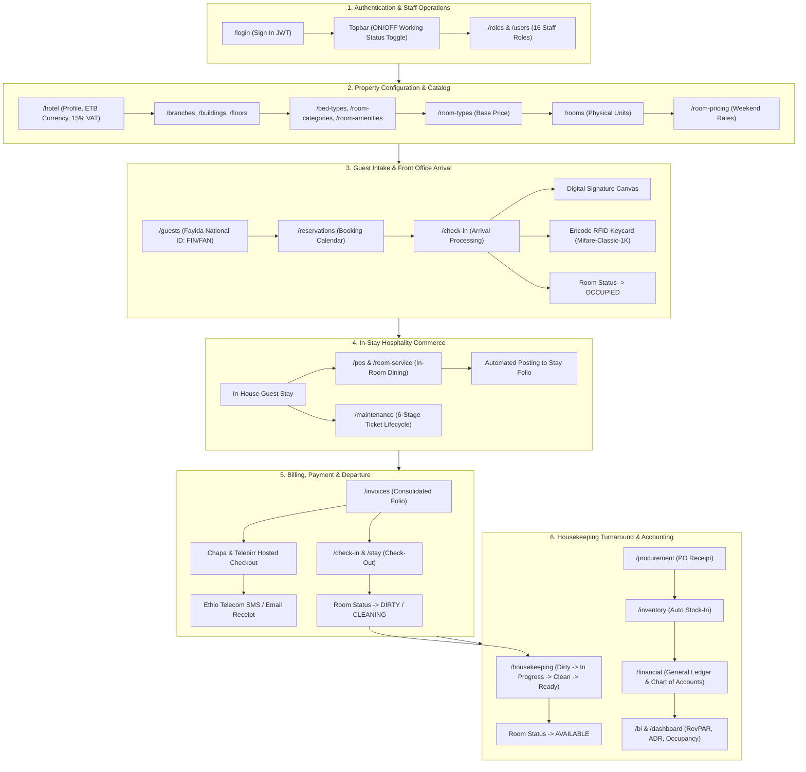

# Nexus HMS Enterprise — Complete End-to-End Operational Manual & Master Plan (`plan.md`)

**System Name:** Nexus Hotel Management System (HMS) Enterprise Platform  
**Document Type:** Master Operational Workflow & Step-by-Step Manual Testing Plan  
**Target Users:** General Managers, Front Desk Receptionists, Cashiers, Housekeepers, Engineers, Accountants  
**Live Application Portal:** [http://localhost:3000](http://localhost:3000)  
**API Engine & Swagger Docs:** [http://localhost:8080/api/docs](http://localhost:8080/api/docs)  
**Database:** PostgreSQL 17 on Port `5433` (`hotel_management`)  
**Default Master Credentials:** `admin@nexushms.com` / `Admin@1234`  

---

## 1. Master System Workflow Architecture



---

## Step-by-Step Manual Test Walkthrough (The Diplomatic Stay Scenario)

Follow each step below in order on your live running system. Every step provides the exact URL, fields to fill, button to click, and expected visual confirmation.

---

### Phase 1: Authentication, Staff Duty Status & User Administration

#### Step 1.1: Sign In to the System
1. Open your web browser and navigate to: **[`http://localhost:3000/login`](http://localhost:3000/login)**
2. In the Sign-In card, enter:
   * **Email:** `admin@nexushms.com`
   * **Password:** `Admin@1234`
3. Click the **"Sign In"** button.
4. **Expected Result:**
   * You are redirected to the main Dashboard (`/dashboard`).
   * In the top-right corner, you will see your avatar with the label **"System Admin"**.

#### Step 1.2: Verify & Toggle Real-Time Staff Working Status (ON/OFF Duty)
1. Look at the top navigation bar next to your profile.
2. Locate the **Duty Status Indicator badge** (displays either `🟢 ON DUTY` or `⚪ OFF DUTY`).
3. Click the toggle switch:
   * When switched to **ON DUTY**: The badge glows emerald green (`🟢 ON DUTY`).
   * When switched to **OFF DUTY**: The badge displays neutral gray (`⚪ OFF DUTY`).
4. **Behind the Scenes:** The NestJS API server updates your `is_on_duty` boolean in the PostgreSQL `users` table via `PATCH /api/users/:id/duty-status`.
5. Navigate to **[`http://localhost:3000/users`](http://localhost:3000/users)** to confirm that staff users display their live duty badge in the staff directory table.

#### Step 1.3: Inspect Staff Roles & Access Permissions
1. Navigate to: **[`http://localhost:3000/roles`](http://localhost:3000/roles)**
2. Notice the pre-configured enterprise roles: *System Admin, Hotel Manager, Receptionist, Cashier, Housekeeping Staff, Maintenance Staff, Accountant, and Storekeeper*.
3. Verify that permissions can be dynamically audited across all 54 system modules.

---

### Phase 2: Hotel Infrastructure, Room Catalog & Dynamic Pricing

#### Step 2.1: Master Hotel Identity & Currency Configuration
1. Navigate to: **[`http://localhost:3000/hotel`](http://localhost:3000/hotel)**
2. Click **"Edit Details"** and review the master property settings:
   * **Hotel Name:** `Nexus Hotel Addis Ababa`
   * **Legal Name:** `Nexus Hospitality Group PLC`
   * **Star Rating:** `5 Stars`
   * **Country / City:** `Ethiopia / Addis Ababa`
   * **Address:** `Bole Sub-City, Next to Millennium Hall`
   * **Default Currency:** `ETB` (Ethiopian Birr)
   * **Standard VAT Rate:** `15.00%`
3. Click **"Save Configuration"**.

#### Step 2.2: Branches, Buildings & Floors Assembly
1. Navigate to: **[`http://localhost:3000/branches`](http://localhost:3000/branches)** $\rightarrow$ Confirm `Main Property (Bole Branch)`.
2. Navigate to: **[`http://localhost:3000/buildings`](http://localhost:3000/buildings)**:
   * Building: `Main Tower` (or click **Add Building** to create `Diplomatic Wing`).
3. Navigate to: **[`http://localhost:3000/floors`](http://localhost:3000/floors)**:
   * Confirm floors `Floor 1` through `Floor 5` are active.

#### Step 2.3: Room Types & Physical Room Assembly
1. Navigate to: **[`http://localhost:3000/room-types`](http://localhost:3000/room-types)**:
   * Check that `Presidential Diplomatic Suite` exists (or create one with **Base Rate:** `12,000.00 ETB`).
2. Navigate to: **[`http://localhost:3000/rooms`](http://localhost:3000/rooms)**:
   * Locate Room `101` (or click **"Add Room"** to create Room `101` assigned to `Presidential Diplomatic Suite`).
   * Confirm Room `101` shows the status badge **`AVAILABLE`** in green.

#### Step 2.4: Dynamic Pricing Window
1. Navigate to: **[`http://localhost:3000/room-pricing`](http://localhost:3000/room-pricing)**.
2. Review dynamic pricing rules (e.g., Weekend Rate markup or High-Season Diplomatic Discount).

---

### Phase 3: Guest Profile Intake with Ethiopian National ID (Fayida)

#### Step 3.1: Register a New Guest with Fayida ID
1. Navigate to: **[`http://localhost:3000/guests`](http://localhost:3000/guests)**.
2. Click the **"Register Guest"** button.
3. In the registration modal, fill in the following test data:
   * **First Name:** `Ambassador Haile`
   * **Last Name:** `Selassie`
   * **Email:** `ambassador.haile@mfa.gov.et`
   * **Phone Number:** `+251-911-554433`
   * **Nationality:** `Ethiopian`
   * **Fayida ID (FIN / FAN):** `FAN-2026-998877-ET` *(Notice the dedicated Ethiopian National ID field!)*
   * **VIP Status:** Toggle **Yes (VIP Guest)**
   * **VIP Level:** `Diplomatic`
   * **Special Requests:** `Quiet suite, diplomatic motorcade parking, sparkling water.`
4. Click **"Save Guest"**.
5. **Expected Result:**
   * The guest appears in the guest directory with a prominent gold **VIP** badge.
   * Clicking on the guest profile displays their verified **Fayida Identification Number (FAN)**.

---

### Phase 4: Advance Reservation & Booking Calendar

#### Step 4.1: Book an Advance Reservation
1. Navigate to: **[`http://localhost:3000/reservations`](http://localhost:3000/reservations)**.
2. Click the **"New Reservation"** button.
3. Fill in the reservation details:
   * **Guest:** Select `Ambassador Haile Selassie`
   * **Room:** Select Room `101` *(Presidential Diplomatic Suite)*
   * **Check-In Date:** Select **Today's Date**
   * **Check-Out Date:** Select **3 Days from Today**
   * **Adults:** `2` | **Children:** `0`
   * **Total Amount:** `36,000.00 ETB` *(3 nights × 12,000 ETB)*
   * **Status:** Select `Confirmed`
4. Click **"Confirm Reservation"**.
5. **Expected Result:**
   * The reservation is created with a unique confirmation code (`RES-XXXXXX`).
   * Navigate to **[`http://localhost:3000/reservations/calendar`](http://localhost:3000/reservations/calendar)** to view the visual booking bar spanning today through the next 3 days.

---

### Phase 5: Front Desk Arrival, Digital Signature Canvas & RFID Keycard

This is where the Phase 1 & Phase 3 hardware and signature features come to life!

#### Step 5.1: Open Check-In Modal
1. Navigate to: **[`http://localhost:3000/check-in`](http://localhost:3000/check-in)**.
2. In the Pending Arrivals table, find **Ambassador Haile Selassie** (Room `101`).
3. Click the **"Check In"** action button.

#### Step 5.2: Complete Identity Verification & Digital Signature
1. The Check-In dialog opens:
   * Confirm guest name and room assignment `101`.
   * Check the checkbox: **"Identity Verified (Ethiopian Fayida ID)"**.
   * Enter **Deposit Amount:** `2000` (ETB).
2. Locate the **Digital Signature Pad**:
   * Use your mouse, touch screen, or stylus to **draw a signature** directly on the white canvas pad!
   * Click the **"Accept Signature"** button below the pad.
   * Notice the signature turns to a green verified badge with timestamp.
3. Click **"Complete Check-In"**.
4. **Expected Result:**
   * The reservation status updates to **`Checked In`**.
   * Room `101` status automatically turns to **`OCCUPIED`** across the system!

#### Step 5.3: Program Electronic RFID Room Keycard
1. In the Check-In table or stay drawer, locate the guest's record.
2. Click the **"Encode RFID Keycard"** button.
3. **Expected Result:**
   * The electronic door lock interface executes the **Mifare-Classic-1K** sector encoding routine.
   * A success alert displays:
     ```text
     Keycard successfully encoded!
     Protocol: Mifare-Classic-1K
     Card Number: RFID-101-MVEY...
     Valid Through: 3 Days
     ```
   * The encoded keycard UID is permanently linked to the guest's stay folio in the database!

---

### Phase 6: In-Stay Commerce — Room Service Auto-Posting to Folio

#### Step 6.1: Order In-Room Dining
1. Navigate to: **[`http://localhost:3000/room-service`](http://localhost:3000/room-service)** (or `/pos`).
2. Click **"New Order"**:
   * **Room:** Select Room `101` *(Ambassador Haile Selassie)*
   * **Menu Items:**
     - *1 × Special Beef Tibs with Injera* (`850.00 ETB`)
     - *2 × Fresh Avocado Juice* (`300.00 ETB`)
   * **Subtotal:** `1,150.00 ETB`
   * **15% VAT:** `172.50 ETB`
   * **Total Bill:** `1,322.50 ETB`
3. Check the option: **"Charge to Room Folio"**.
4. Click **"Dispatch Order"**.
5. **Expected Result:**
   * The kitchen order is dispatched.
   * **Crucial Phase 2 Feature:** Open **[`http://localhost:3000/invoices`](http://localhost:3000/invoices)** and inspect the folio for Room `101`.
   * The `1,322.50 ETB` culinary charge is **automatically posted to the guest's stay invoice**, itemized with 15% VAT!

---

### Phase 7: Engineering & Facilities — 6-Stage Maintenance Workflow

#### Step 7.1: Report & Log a Maintenance Ticket
1. Navigate to: **[`http://localhost:3000/maintenance`](http://localhost:3000/maintenance)**.
2. Click **"New Ticket"**:
   * **Room / Location:** Room `101` (or Room `105`)
   * **Category:** `HVAC / Climate Control`
   * **Priority:** `High`
   * **Title:** `Balcony Sensor Calibration`
   * **Description:** `Calibrate digital thermostat sensor.`
3. Click **"Submit Ticket"**:
   * **Stage 1 (Reported):** Ticket enters the queue.
   * **Stage 2 (Logged):** System generates tracking ticket ID.

#### Step 7.2: Dispatch, Execute & Verify the 6 Stages
1. In the maintenance board, open the ticket:
   * Click **"Assign Technician"** $\rightarrow$ Select `Lead HVAC Tech`.
   * **Stage 3 (Assigned):** Status updates; technician is notified.
2. When technician begins work:
   * Click **"Start Work"** $\rightarrow$ **Stage 4 (In Progress)**.
3. When work is completed:
   * Enter resolution notes: `Sensors recalibrated to standard 21°C.`
   * Click **"Mark Completed"** $\rightarrow$ **Stage 5 (Completed)**.
4. When Chief Engineer conducts final inspection:
   * Click **"Verify & Close"** $\rightarrow$ **Stage 6 (Verified)**.
5. **Expected Result:**
   * Ticket displays green **Verified** safety seal and moves to archived audit logs.

---

### Phase 8: Financial Settlement, Online Payment (Telebirr/Chapa) & Check-Out

#### Step 8.1: Review Consolidated Folio on `/invoices`
1. Navigate to: **[`http://localhost:3000/invoices`](http://localhost:3000/invoices)**.
2. Click on the invoice for **Ambassador Haile Selassie (Room 101)**.
3. Review the complete consolidated summary:
   * **Room Nights (3 Nights @ 12,000 ETB):** `36,000.00 ETB`
   * **In-Room Dining (Special Tibs & Juice):** `1,322.50 ETB`
   * **Subtotal:** `37,322.50 ETB`
   * **Less Security Deposit Paid at Check-In:** `-2,000.00 ETB`
   * **Balance Due:** `35,322.50 ETB`

#### Step 8.2: Process Online Hosted Payment (Chapa / Telebirr)
1. In the invoice action bar, locate the blue **"Pay Online"** button.
2. Click **"Pay Online"**:
   * Select **Provider:** `Telebirr / Chapa Gateway`
   * Customer Phone: `+251-911-554433`
   * Click **"Initiate Payment Session"**.
3. **Expected Result:**
   * System generates a hosted checkout session (`txRef: TX-XXXXX`).
   * Launches the secure checkout gateway URL.
   * Upon gateway confirmation, the system updates invoice status to **`PAID`** (`Balance: 0.00 ETB`)!
   * An automated confirmation SMS is delivered via the **Ethio Telecom SMS Gateway**.

#### Step 8.3: Execute Final Front Desk Check-Out
1. Navigate to: **[`http://localhost:3000/check-in`](http://localhost:3000/check-in)** (or `/stay-management`).
2. Locate Room `101`.
3. Click **"Check Out"**:
   * Confirm that keycard `RFID-101-MVEY...` is returned.
   * Confirm outstanding folio balance is `0.00 ETB`.
   * Guest rating: `5 Stars - Outstanding stay`.
4. Click **"Complete Check-Out"**.
5. **CRITICAL REACTION:**
   * Reservation updates to **`Checked Out`**.
   * Room `101` status **instantly turns to `CLEANING / DIRTY`** in red!

---

### Phase 9: Housekeeping Turnaround & Room Availability Matrix Sync

#### Step 9.1: Housekeeping Task Board
1. Navigate to: **[`http://localhost:3000/housekeeping`](http://localhost:3000/housekeeping)**.
2. Notice Room `101` is prominently listed under **Pending Turnover** with status **`DIRTY`**.

#### Step 9.2: Advance Through the 4-Stage Cleaning Pipeline
1. Housekeeper clicks **"Start Cleaning"**:
   * Status transitions to **`IN PROGRESS`** (yellow badge).
2. Housekeeper completes sanitizing, linen replacement, and amenity replenishment:
   * Click **"Mark Clean"**:
   * Status transitions to **`CLEAN`** (blue badge).
3. Floor Supervisor inspects the suite:
   * Click **"Approve & Release"**:
   * Status transitions to **`READY / AVAILABLE`** (green badge).
4. **Final Synchronization:**
   * Navigate to **[`http://localhost:3000/rooms`](http://localhost:3000/rooms)** and **[`http://localhost:3000/availability`](http://localhost:3000/availability)**.
   * Room `101` is once again **`AVAILABLE`** and ready for the next incoming guest booking!

---

### Phase 10: Back Office, Procurement Auto Stock-In & General Ledger

#### Step 10.1: Procurement PO Auto Stock-In
1. Navigate to: **[`http://localhost:3000/procurement`](http://localhost:3000/procurement)**.
2. Locate a Purchase Order (e.g. `PO-1001` for Ethiopian Yirgacheffe Coffee Pods).
3. Click **"Receive Items"**:
   * **Phase 2 Automation:** Notice that clicking receive **automatically updates stock counts in [`/inventory`](http://localhost:3000/inventory)**!
   * No manual inventory reentry required.

#### Step 10.2: Chart of Accounts & General Ledger Audit
1. Navigate to: **[`http://localhost:3000/financial`](http://localhost:3000/financial)**.
2. Select the **General Ledger** tab:
   * Notice standard Ethiopian COA accounts:
     - `Account 1010` (Operating Cash)
     - `Account 1030` (Telebirr Clearing Account)
     - `Account 1200` (F&B Inventory Asset)
     - `Account 2050` (VAT Payable 15% - output tax collected)
     - `Account 4010` (Room Accommodation Revenue)
   * Verify the **Trial Balance**: Total Debits equal Total Credits with zero variance.

#### Step 10.3: Executive Hospitality KPIs
1. Navigate to: **[`http://localhost:3000/bi`](http://localhost:3000/bi)** and **[`http://localhost:3000/dashboard`](http://localhost:3000/dashboard)**.
2. Review calculated hospitality intelligence:
   * **Occupancy Rate (%)**
   * **Average Daily Rate (ADR)**
   * **Revenue Per Available Room (RevPAR)**
   * **Departmental Revenue Breakdown (Rooms vs. F&B vs. Banquets)**

---

## 3. Quick Reference: End-to-End Test Execution Checklist

Print this checklist or check off each item during your walkthrough:

| Step # | Screen Route | Action Description | Verification Checkmark |
| :---: | :--- | :--- | :---: |
| **1** | `/login` | Sign in with `admin@nexushms.com` / `Admin@1234` | [ ] |
| **2** | Topbar | Toggle ON/OFF Working Status badge (`🟢 ON DUTY`) | [ ] |
| **3** | `/hotel` | Verify Currency: `ETB`, VAT: `15%`, Star Rating: `5` | [ ] |
| **4** | `/rooms` | Confirm Room `101` is `AVAILABLE` | [ ] |
| **5** | `/guests` | Create Guest with Fayida ID: `FAN-2026-998877-ET` | [ ] |
| **6** | `/reservations` | Book Room `101` for 3 nights for Ambassador Haile | [ ] |
| **7** | `/check-in` | Capture signature on Digital Pad & complete check-in | [ ] |
| **8** | `/check-in` | Click "Encode RFID Keycard" (Mifare-Classic-1K) | [ ] |
| **9** | `/rooms` | Verify Room `101` automatically changed to `OCCUPIED` | [ ] |
| **10** | `/room-service`| Order meal; verify auto-post to Room `101` invoice | [ ] |
| **11** | `/maintenance` | Advance maintenance ticket through 6 stages to `Verified` | [ ] |
| **12** | `/invoices` | Click "Pay Online" via Telebirr/Chapa hosted checkout | [ ] |
| **13** | `/check-in` | Complete Check-Out; verify Room `101` turns `CLEANING` | [ ] |
| **14** | `/housekeeping`| Advance Room `101`: `Dirty -> In Progress -> Clean -> Ready` | [ ] |
| **15** | `/procurement` | Receive PO; verify auto-increment in `/inventory` | [ ] |
| **16** | `/financial` | Verify General Ledger, Chart of Accounts & 15% VAT | [ ] |
| **17** | `/bi` | Review RevPAR, ADR, and Occupancy Rate analytics | [ ] |
