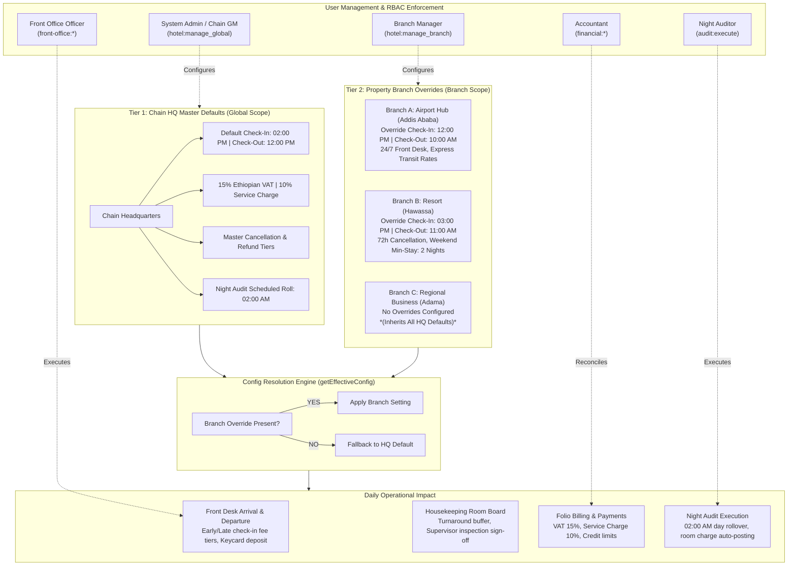

# Hotel Configuration & Daily Operations: SDLC Phased Roadmap

This document outlines the **Software Development Life Cycle (SDLC)** phased roadmap for the **Hotel Configuration and Daily Operations Engine** within the Hotel Management System (HMS).

It synthesizes:
1. **The 2-Tier Architecture** (Chain HQ Defaults vs. Branch Overrides).
2. **Daily Operations Automation** (Front Desk, Housekeeping, Financial Billing, and Night Audit in 12-Hour AM/PM format).
3. **User Management & Role-Based Access Control (RBAC)** (Global vs. Branch-Scoped Permissions).

---

## 1. Architectural Blueprint & Operational Flow



---

## 2. Current Baseline Assessment (What We Have Built)

| Component | Current State in Codebase | Needs Enhancement for Next Phases |
| :--- | :--- | :--- |
| **Hotel Config Page** (`/hotel`) | 7 comprehensive tabs (Identity, Facilities, Media, Policies, Operations, Revenue, Housekeeping). | Needs Property/Branch switcher to configure Branch Overrides vs. HQ Defaults; fee formulas needed. |
| **User & Roles Page** (`/users`) | Integrated User & Role management, multi-branch assignment (`user_branches`), Fayda ID validation, phone validation. | Connect fine-grained permission tokens (`hotel:manage_global`, `hotel:manage_branch`) to the `/hotel` page tabs. |
| **Database Schema** (`lib/db/src/schema/`) | `hotelsTable` has JSONB `settings`, `taxNumber`, `currencyCode`. `branchesTable` has basic metadata. | Add operational override columns (`check_in_time`, `check_out_time`, `star_rating`, `settings` JSONB) to `branchesTable`. |
| **Availability Logic** (`reservations.service.ts`) | Checks date range conflicts. | Remove `status == 'available'` bug on future dates; add branch-level scoping. |

---

## 3. SDLC Phased Milestones

### Milestone 1: Data Model & Schema Migration (Foundation Layer)
*Objective: Equip the database to hold 2-tier configurations, operational fee tiers, and length-of-stay constraints.*

* **Task 1.1: Enhance `branchesTable` (`lib/db/src/schema/branches.ts`)**:
  * Add `checkInTime: text("check_in_time")` (default `NULL` = inherit).
  * Add `checkOutTime: text("check_out_time")` (default `NULL` = inherit).
  * Add `starRating: integer("star_rating")`.
  * Add `latitude: text("latitude")` and `longitude: text("longitude")`.
  * Add `settings: jsonb("settings").default({})` for branch-specific operational overrides.
* **Task 1.2: Expand Operational Parameters in `hotelsTable.settings`**:
  * Early check-in fee tiers (Before 07:00 AM = 100% night rate; 07:00 AM – 10:00 AM = 50% half-day rate; 10:00 AM – 02:00 PM = Free).
  * Late check-out fee tiers (12:00 PM – 12:30 PM = Grace period; 12:30 PM – 03:00 PM = 50% half-day rate; Past 03:00 PM = 100% full night rate).
  * Keycard / RFID deposit amount (e.g. 200 ETB).
  * Day-use window (08:00 AM – 06:00 PM, 60% of rack rate).
  * Ethiopian Tax Breakdown: VAT 15%, Service Charge 10%, City Tax flat fee.
  * Incidental credit limit (e.g. 15,000 ETB) and cashier drawer float limit (e.g. 10,000 ETB).
* **Task 1.3: Add Length of Stay to `roomTypesTable` (`lib/db/src/schema/room-types.ts`)**:
  * Add `minStayDays: integer("min_stay_days").notNull().default(1)`.
  * Add `maxStayDays: integer("max_stay_days").notNull().default(30)`.

---

### Milestone 2: Backend Resolution Engine & Availability Refactor (Service Layer)
*Objective: Build the centralized fallback resolver and fix the room availability calculation.*

* **Task 2.1: Implement `ConfigResolutionService` (`artifacts/api-server/src/modules/hotel/`)**:
  * Create `getEffectiveConfig(branchId?: string)`:
    ```typescript
    // Resolves: Branch Setting ?? HQ Setting ?? System Hardcoded Fallback
    const hq = await getHotelMasterConfig();
    if (!branchId) return hq;
    const branch = await getBranchConfig(branchId);
    return mergeConfigs(hq, branch);
    ```
* **Task 2.2: Refactor `reservations.service.ts:checkAvailability`**:
  * Add mandatory `branchId` parameter:
    ```sql
    JOIN buildings ON rooms.building_id = buildings.id
    WHERE buildings.branch_id = :branchId
    ```
  * Replace the real-time status check:
    * Remove: `eq(roomsTable.status, 'available')`.
    * Replace with: `notInArray(roomsTable.status, ['out_of_service', 'under_maintenance'])`.
    * Keep the date overlap exclusion on existing reservations.
* **Task 2.3: Validation of Booking Offsets**:
  * Enforce `minBookingLeadDays` and `maxBookingAdvanceDays` when booking is placed.

---

### Milestone 3: Hotel Configuration UI Enhancement (Frontend Layer)
*Objective: Upgrade `/hotel` to allow switching between Chain Master Defaults and Branch Overrides in 12-Hour format.*

* **Task 3.1: Scope / Branch Switcher in Header**:
  * Add a top dropdown: `[Global: Chain Master Defaults]` | `[Branch: Addis Ababa Airport]` | `[Branch: Hawassa Resort]`.
  * When a specific branch is selected, inputs display placeholder text showing the inherited Chain default with an "Override" toggle button.
* **Task 3.2: 12-Hour AM/PM Time Format Standardization**:
  * Display all times with clear AM/PM indicators (e.g. `02:00 PM`, `12:00 PM`, `10:00 AM`).
  * Time pickers format to clean 12-hour strings for human front desk readability.
* **Task 3.3: Operations & Timers Tab Enhancements**:
  * Visual cards for Early Check-In and Late Check-Out fee tiers.
  * Night Audit rollover time card (`02:00 AM`).
  * RFID keycard deposit field and cashier shift drawer float limit.
* **Task 3.4: Revenue & Tax Tab Enhancements**:
  * Ethiopian tax matrix: VAT (15%), Service Charge (10%), and Tax-Inclusive pricing switch.
  * Folio credit limit for restaurant/POS room charges.

---

### Milestone 4: Daily Operations Pipeline Integration (Business Logic Layer)
*Objective: Connect the configured parameters directly into daily front desk, billing, and housekeeping workflows.*

* **Task 4.1: Front Desk Arrival Flow (`/front-office` & `/check-in`)**:
  * When checking in before **02:00 PM**, system automatically inspects arrival time:
    * Before **07:00 AM** $\rightarrow$ Adds previous night charge prompt.
    * **07:00 AM – 10:00 AM** $\rightarrow$ Adds 50% half-day fee item.
    * **10:00 AM – 02:00 PM** $\rightarrow$ Complimentary early check-in.
  * Prompts for mandatory **Fayda ID** (domestic) or **Passport** (foreigners).
  * Prompts for Keycard deposit collection.
* **Task 4.2: Front Desk Departure Flow (`/check-out`)**:
  * When checking out past **12:00 PM (Noon)**:
    * Grace period check (up to 12:30 PM = waived).
    * Between **12:30 PM – 03:00 PM** $\rightarrow$ Automatically posts 50% half-day charge.
    * Past **03:00 PM** $\rightarrow$ Automatically posts full 100% room charge.
  * Checks for pending minibar audit and keycard return before deposit refund.
* **Task 4.3: Housekeeping Board Integration (`/housekeeping`)**:
  * On checkout, room automatically flips to configured checkout state (`dirty`).
  * Enforces supervisor inspection sign-off before room status can become `ready`.
* **Task 4.4: Night Audit Automation (`/night-audit`)**:
  * At **02:00 AM**, automated or one-click manual night audit runs:
    1. Posts room rate + 15% VAT + 10% Service Charge to all in-house guests.
    2. Releases non-guaranteed reservations past **06:00 PM**.
    3. Posts 1-night penalty to guaranteed no-shows.
    4. Advances system business date ($D \rightarrow D + 1$).

---

### Milestone 5: User Management & RBAC Permissions (Security Layer)
*Objective: Enforce strict role-based authorization over who can alter hotel configurations.*

#### Permissions & Roles Mapping Matrix

| Role | Scope | Permissions Granted | Can Edit Chain HQ Defaults? | Can Edit Branch Overrides? | Daily Operational Access |
| :--- | :--- | :--- | :---: | :---: | :--- |
| **System Admin** | Global | `*` (Full System Access) | **YES** | **YES** (All Branches) | Full configuration & user management. |
| **General Manager (Chain)** | Global | `hotel:*`, `financial:*`, `reports:*`, `bi:*` | **YES** | **YES** (All Branches) | Corporate oversight and chain policies. |
| **Branch Manager** | Branch | `hotel:manage_branch`, `front-office:*`, `reports:*` | **NO** (Read-Only) | **YES** (Assigned Branch Only) | Local hours, local payment accounts, local emergency contacts. |
| **Front Office Officer** | Branch | `front-office:*`, `reservations:*`, `invoices:*` | **NO** | **NO** | Applies early/late fees, key deposits, room check-in. |
| **Night Auditor** | Branch | `audit:execute`, `financial:*`, `reports:*` | **NO** | **NO** | Executes 02:00 AM roll, reviews no-show penalties. |
| **Chief Accountant** | Global / Branch | `financial:*`, `invoices:*`, `payments:*` | **YES** (Tax/Prefixes) | **YES** (Bank Accounts) | Configures 15% VAT, 10% Service Charge, cashier float. |
| **Executive Housekeeper** | Branch | `housekeeping:*`, `rooms:*` | **NO** | **YES** (Linen & Turnaround) | Housekeeping cleaning triggers, inspection standards. |

#### UI Enforcement:
* If a `Branch Manager` logs in, the `/hotel` page locks Tier 1 Global Defaults into read-only badges and opens Tier 2 controls for their assigned property.
* If a `Front Office Officer` visits `/hotel`, the page renders in view-only mode.

---

## 4. Verification & Testing Matrix

| Milestone | Test Scenario | Acceptance Criteria |
| :--- | :--- | :--- |
| **M1: Schema** | Run migrations on PostgreSQL. | Tables accept new columns without regression on existing records. |
| **M2: Config Engine** | Call `getEffectiveConfig(branchId)` on branch with no overrides. | Successfully returns Chain HQ defaults. |
| **M2: Availability** | Search room availability for next month while room is occupied today. | Room is reported as **Available** (no false negative). |
| **M3: UI 12-Hour** | Inspect `/hotel` Operations & Timers tab. | All times render in `hh:mm AM/PM` format. Branch switcher toggles overrides. |
| **M4: Front Desk** | Check in at 08:30 AM; check out at 02:00 PM. | System calculates and applies 50% early arrival fee and 50% late departure fee. |
| **M4: Night Audit** | Run night audit at 02:00 AM. | Business date increments; room rate + 15% VAT + 10% Service Charge are posted to folios. |
| **M5: RBAC** | Log in as Branch Manager and attempt to edit Chain HQ master tax. | Request rejected with HTTP 403 Forbidden; UI disable lock active. |
