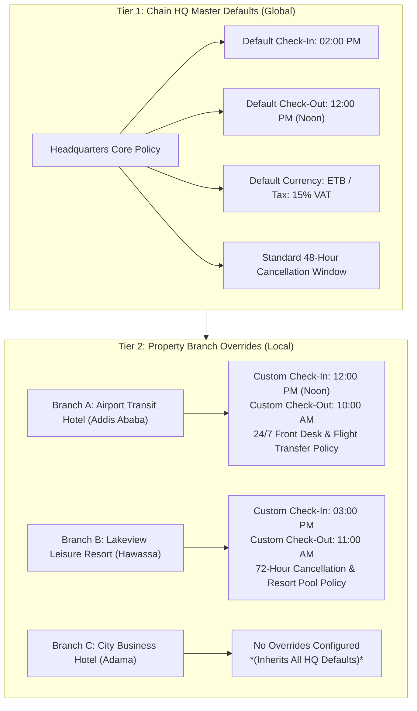

# Hotel Configuration Architecture & 2-Tier System Guide

This document explains the technical architecture, operational rationale, and database design for our **2-Tier Hotel Configuration** and **Room Availability Engine**.

---

## 1. What is the 2-Tier Configuration Model?

In a multi-property hotel chain, operational requirements differ by location. A single rigid set of rules cannot fit every property.



### The Fallback Inheritance Rule
1. **Check the Branch**: When the system needs a configuration value (e.g., check-in time, cancellation rules, tax ID, or operational policy), it first looks at the specific property branch.
2. **Fallback to HQ**: If the branch has not set a custom override, the system automatically falls back to the Chain HQ default.

---

## 2. Real-World Branch Differences (12-Hour Format Examples)

| Configuration Field | Tier 1: Chain HQ Default | Tier 2: Airport Branch (Addis Ababa) | Tier 2: Resort Branch (Hawassa) | Why the Override Exists |
| :--- | :--- | :--- | :--- | :--- |
| **Check-In Time** | **02:00 PM** | **12:00 PM (Noon)** | **03:00 PM** | Airport travelers arrive on early international flights; resort housekeeping requires extra turnaround time for expansive villas. |
| **Check-Out Time** | **12:00 PM (Noon)** | **10:00 AM** | **11:00 AM** | Airport rooms must be cleaned rapidly for mid-day check-ins; resort guests enjoy relaxed mornings. |
| **Desk Operations** | 16 Hours (06:00 AM – 10:00 PM) | 24 Hours Continuous | 18 Hours (06:00 AM – 12:00 AM Midnight) | Flight schedules demand overnight front office staffing at airport hubs. |
| **Cancellation Notice** | 48 Hours Before Arrival | 24 Hours Before Arrival | 72 Hours Before Arrival | Business travelers need flexibility; vacation resorts require longer lead times to re-sell rooms. |
| **Child & Extra Bed** | Standard Policy | Cribs & Day-Use Rates | Rollaway Beds & Lake Activities | Resort caters to families; transit hotel caters to solo business travelers. |

---

## 3. Availability Calculation Explained

### The Common Flaw
In naive systems, availability is calculated with a simple query:
```sql
-- FLAWED LOGIC:
SELECT * FROM rooms WHERE status = 'available';
```
**Why this fails:**
* If guest Mr. Abebe is sleeping in Room 101 **tonight**, the room's live status is `occupied`.
* If a customer visits the website to book Room 101 for **next month (Dec 1st – Dec 5th)**, the flawed query checks `status = 'available'`, sees `occupied`, and incorrectly claims: *"Room 101 is not available next month!"*

### The Proper Hospitality Availability Engine
A room's availability for a requested date range ($[\text{Check-In}, \text{Check-Out}]$) depends strictly on **two rules**:

1. **Physical Operational Condition**:
   - The room must not be permanently out of service or under construction (`status NOT IN ('out_of_service', 'under_maintenance')`).
   - Normal housekeeping states (`dirty`, `cleaning`, `occupied` *today*) do **not** block future dates.

2. **Date Collision Check (No Confirmed Overlaps)**:
   - Does this room have any existing confirmed reservation where:
     $$\text{Existing Check-In} < \text{Requested Check-Out} \quad\text{AND}\quad \text{Existing Check-Out} > \text{Requested Check-In}$$
   - If **NO overlapping reservation exists** for those dates, the room is **Available**.

3. **Branch Scoping**:
   - Availability must always be scoped to the selected Branch ID (`buildings.branch_id = :target_branch`). A customer searching for a room in Addis Ababa must never be shown rooms from Hawassa.

---

## 4. Database Schema Alignment

### Tier 1: Chain Master (`hotels` table)
```sql
hotels (
  id                  UUID PRIMARY KEY,
  hotel_name          TEXT NOT NULL,
  default_check_in    TEXT DEFAULT '02:00 PM',
  default_check_out   TEXT DEFAULT '12:00 PM',
  timezone            TEXT DEFAULT 'Africa/Addis_Ababa',
  currency_code       TEXT DEFAULT 'ETB',
  tax_number          TEXT,
  settings            JSONB DEFAULT '{}'
);
```

### Tier 2: Branch Overrides (`branches` table)
```sql
branches (
  id                  UUID PRIMARY KEY,
  hotel_id            UUID REFERENCES hotels(id),
  branch_name         TEXT NOT NULL,
  branch_code         TEXT UNIQUE NOT NULL,
  -- Operational Overrides (NULL means inherit from Chain HQ)
  check_in_time       TEXT DEFAULT NULL,   -- e.g. '12:00 PM'
  check_out_time      TEXT DEFAULT NULL,   -- e.g. '10:00 AM'
  star_rating         INTEGER DEFAULT NULL,
  latitude            TEXT DEFAULT NULL,
  longitude           TEXT DEFAULT NULL,
  settings            JSONB DEFAULT '{}'   -- Branch-specific policy overrides
);
```

---

## 5. Summary Checklist for Implementation

- [ ] **Database Migration**: Add `check_in_time`, `check_out_time`, `star_rating`, `latitude`, `longitude`, and `settings` to `branchesTable`.
- [ ] **Helper Function**: Create `getEffectiveBranchConfig(branchId)` that merges Branch settings on top of Chain HQ defaults.
- [ ] **Availability Query**: Update `reservations.service.ts` to filter by `branchId` and remove the `rooms.status == 'available'` restriction for future calendar dates.
- [ ] **UI Presentation**: Standardize all operational times in UI cards and inputs to 12-hour format with AM/PM indicators.
